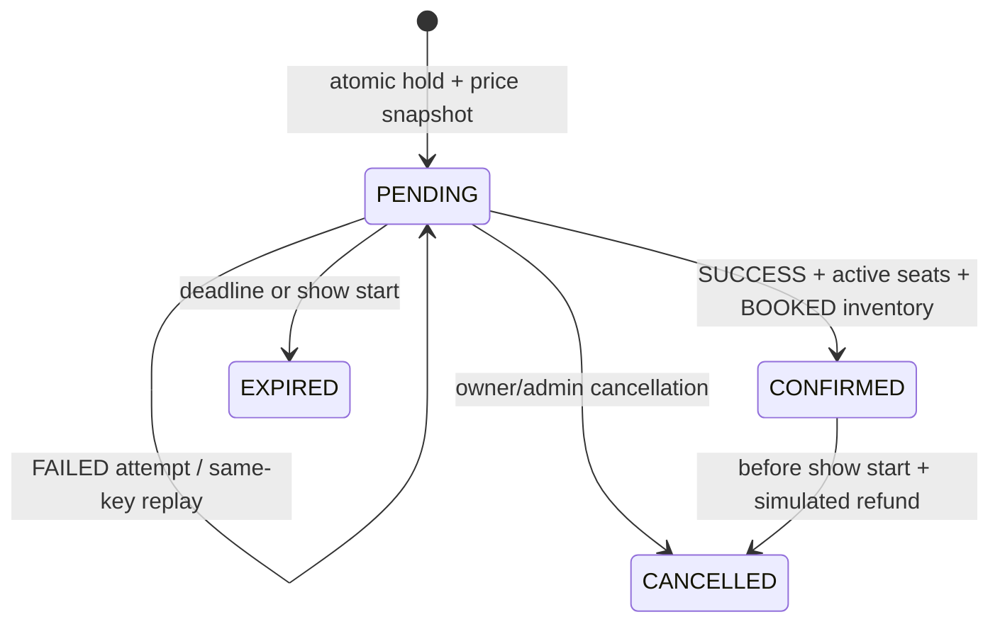

# Schema and correctness decisions

Eleven domain tables: `users`, `movies`, `theatres`, `auditoriums`, `seats`, `shows`, `show_seats`, `bookings`, `booking_seats`, `payments`, `offers`. `schema_migrations` is runner metadata, not an extra domain entity. All generated identifiers are BIGINT GENERATED ALWAYS AS IDENTITY. Required relationships, monetary fields, statuses, offer ranges, and creation timestamps are NOT NULL. Statuses use CHECK constraints rather than PostgreSQL enums to keep later migrations simple. All foreign keys use RESTRICT; booking-related history has no cascading delete.

## Small adjustments from the supplied design

- `show_seats.auditorium_id` is deliberately redundant. Composite foreign keys `(show_id,auditorium_id)` and `(seat_id,auditorium_id)` make mismatched physical seats impossible, including under concurrent writes and parent updates. Supporting composite UNIQUE constraints are added to shows/seats.
- `booking_seats.show_id` is redundant for the same reason: composite foreign keys guarantee that a booking's show matches its ShowSeats. The requested composite primary key `(booking_id,show_seat_id)` remains.
- Unique `(auditorium_id,row,column)` prevents two seats occupying the same physical coordinate. Audi numbers and seat columns are positive.
- A lock-shape CHECK requires both lock owner/expiry only for LOCKED seats, and neither for other statuses. M2 preserves this constraint and adds a current booking pointer.
- Emails must be lowercase in storage, with a UNIQUE constraint; registration also trims whitespace. Offers limit PERCENTAGE to 100, require positive discount values and ordered validity timestamps. Money uses NUMERIC(10,2), with positive seat prices and nonnegative booking/payment amounts.

## Scheduling and transactions

`btree_gist` allows a GiST exclusion constraint on `(auditorium_id WITH =, tstzrange(start_time,end_time,'[)') WITH &&)`. PostgreSQL rejects overlapping show intervals in the same auditorium even when concurrent transactions attempt inserts. `[)` allows a show to begin exactly when another ends. No implicit cleanup buffer or movie-runtime matching rule is invented; callers supply the intended interval.

Show creation locks its auditorium row, inserts a show and bulk-inserts ShowSeats from its physical layout in one transaction. Empty layouts roll back. API seat writes acquire the same auditorium lock and reject changes once shows exist, preventing a show/seat creation race from generating an incomplete inventory. Foreign keys provide invariant enforcement even outside the API; direct SQL scheduling must also populate inventory transactionally, as the seed does. M2 booking code locks the show row before booking creation, then the requested ShowSeat rows consistently; M1 show edits/deletes already lock the show row. An administrator cannot change a show's prices or delete it once any booking history exists.

`show_seats` uniqueness prevents duplicated inventory. There is no permanent unique constraint on `booking_seats.show_seat_id`: cancelled/expired booking history may legitimately reference the same seat. M2 adds a partial unique constraint for active ownership and replaces M1's single-payment restriction with replayable attempts (details below). Transaction ID remains unique.

## Indexes and timestamps

Primary/unique/exclusion constraints create their own indexes. Extra indexes support movie/start-time and date show searches, reverse seat references, booking-user/show/offer foreign keys, booking-seat references, and non-null lock owner references. Composite keys already cover theatre/auditorium and show-inventory lookups. Location/language scans are adequate for a small catalog; add search indexes only after measured need.

TIMESTAMPTZ stores instants; server connections use UTC and timestamp inputs require offsets. Show date filters explicitly use UTC day boundaries. PostgreSQL DATE is returned as a calendar string, avoiding local timezone conversion. IDs and money remain strings in JSON to avoid JavaScript precision loss. SQL values are parameterized; identifiers are selected only from server-owned definitions.

## M2 lifecycle and concurrency

Migration `002_booking_lifecycle.sql` adds no domain tables and never edits migration 001:

- Bookings: unique UUID `hold_id`, `expires_at`, and per-user UUID `idempotency_key`. The identity is never reused, so a stale request cannot act on a later hold by the same user.
- ShowSeats: nullable `current_booking_id` with a same-show composite foreign key. This is the current owner for both held and confirmed seats. AVAILABLE seats cannot retain a pointer. Release statements match this pointer, not just a user ID.
- BookingSeats: snapshotted NUMERIC `price` and `active`. A unique partial index on `show_seat_id WHERE active` prevents duplicate active allocations at the database layer. Confirmation sets active; cancellation clears it while preserving history.
- Payments: one row per attempt, unique `(booking_id,idempotency_key)`, recorded request outcome, REFUNDED status/timestamp, and a partial unique index allowing at most one SUCCESS/REFUNDED charge per booking. Keeping failed attempts is necessary to replay an old failed key accurately after a later success; overwriting a single row would lose that result.

M1 rows with no reservation identity remain readable. Existing association prices are backfilled from inventory; confirmed associations become active and link booked inventory to their booking. Because M1 never snapshotted historical prices, those legacy per-seat values are the best available catalog values; their existing booking/payment totals are preserved. The nullable price column permits legacy M1 SQL, while every M2 API-created association supplies a snapshot. A legacy pending booking without a hold identity cannot be paid through M2. Unlinked legacy BOOKED inventory stays unavailable rather than being silently released. If an M1 database already has contradictory duplicate confirmed associations, the unique-index migration fails transactionally and requires data reconciliation; it never discards history to force an upgrade.

Booking transitions:

Seat transitions: AVAILABLE -> LOCKED on reservation; LOCKED -> BOOKED on successful payment; LOCKED -> AVAILABLE on expiry/cancellation; BOOKED -> AVAILABLE on confirmed cancellation. Stored expired locks are logically AVAILABLE immediately. Reads project expiration, while show-scoped write/detail transactions lazily persist it. No worker is necessary. Abandoned reservations remain EXPIRED history, not reusable identities.

### Transaction boundaries and lock ordering

Every lifecycle write is a short database transaction. It locks one show (`FOR UPDATE`), expires pending reservations for that show in booking-ID order, then locks the target booking and its ShowSeats in ascending ID order. Hold creation locks requested ShowSeats in that order, validates the entire selection, inserts the booking/associations and assigns inventory atomically. All paths use the same show lock, including M1 admin mutation. This intentionally serializes operations **within a show**; separate shows can progress concurrently. It is a practical portfolio tradeoff rather than a claim of maximum throughput.

After lock acquisition, expiry decisions use `clock_timestamp()` rather than transaction-start `now()`, so a request delayed on a lock cannot use a stale timestamp. Ownership is validated at that transaction's decision point; no transaction is held while a customer decides or while calling external services. The deadline is min(database clock + configured TTL, show start). Prices are summed by PostgreSQL NUMERIC at hold creation and snapshotted; payments use the stored booking total, never client prices or floating-point arithmetic.

Payment success inserts its attempt, sets active ownership, marks inventory BOOKED and confirms the booking in one commit. Any error rolls everything back, including the simulated financial record. Cancellation clears active associations, releases only matching current-booking pointers and records a full simulated refund in one commit. History is preserved. Repeated cancellation is a read of the existing state, not another refund.

The partial unique indexes and foreign keys enforce structural uniqueness and relationships; the service transactions enforce lifecycle/payment transitions. Direct SQL writers must follow this protocol and must not independently set booking statuses. There are no external gateway charges to reconcile in M2. Simulation is disabled in production, and this test suite does not constitute a claim of production payment readiness.

Transactions use a 3-second lock timeout and 10-second statement timeout. Lock timeout, deadlock, serialization failure and query cancellation return a sanitized retryable 409 after rollback. No automatic retry is performed on potentially ambiguous connection/commit failures; callers retry with the same durable idempotency key. Broken connections are discarded if rollback fails. Read history uses a read-only REPEATABLE READ snapshot for consistent pages/details. Essential new indexes cover pending expiry, user history, current seat owners and idempotency lookups.

## M3 integration and demo data

M3 does not change migrations 001 or 002 or the eleven-entity model. The frontend consumes the existing transaction-safe lifecycle APIs. `src/db/seeds/demo.js` adds six fictional movies, three theatres, forty seats per auditorium and sixty-three future shows with ShowSeat inventory. The development-only seed uses a transaction and advisory lock, and recognizes its marker theatre on subsequent runs. Existing data is preserved. Dates are generated on first insertion and are not automatically advanced on restart; add later shows through the admin UI as needed.
